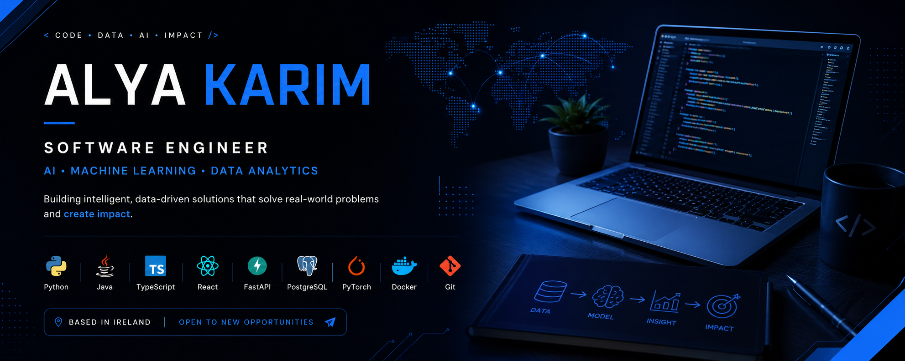

# Hi, I'm Alya

I build software in Python and TypeScript: full stack apps, machine learning pipelines, and the data work underneath them. Based in Ireland.

I did my MSc in Data Analytics at TUS, where I built a drone assisted human detection system for search and rescue with YOLOv8. Before that a Certificate in Software Engineering with Ericsson, and a BSc in Applied Physics at UTP where programming started for me with C and an Arduino.

Physics into data into engineering is a strange path, but it means I am comfortable anywhere from a database schema to a training run. I have been leaning into software engineering while keeping the data science sharp.

**What I reach for most:** Python, TypeScript, SQL, React, FastAPI, PyTorch, PostgreSQL, Docker, Linux

Outside of code: film photography, painting, pottery I am still failing at. Same messy trial and error as a training run, just with worse odds. Trying to learn something new every day.

## Featured Projects

### [DevDesk](https://github.com/alymkarim/DevDesk)

Full stack e-commerce store for developer workspace gear, from catalog through Stripe checkout.

* JWT auth with password reset, reviews, wishlist and discount codes
* Cart for guests and signed in users, with order tracking, Docker Compose and GitHub Actions CI

**Stack:** FastAPI, React, TypeScript, Tailwind CSS, PostgreSQL, Stripe

**[Live Demo](https://dev-desk-nine.vercel.app)**

### [ContagionLab](https://github.com/alymkarim/ContagionLab)

Financial contagion engine. It builds correlation networks from asset returns and pushes shocks through them to show where systemic risk spreads.

* Six network construction methods compared, with Random Matrix Theory filtering, Monte Carlo stress tests and replays of past crises
* FastAPI backend with a React frontend and an interactive force graph

**Stack:** Python, FastAPI, NetworkX, pandas, React, TypeScript

**[Live Demo](https://contagionlab.vercel.app)**

### [ResearchIQ](https://github.com/alymkarim/researchiq)

Research paper analysis platform. Upload a PDF and get objectives, methodology, findings, strengths and limitations pulled out in seconds.

* Semantic search across a paper collection with RAG, plus side by side comparison of two papers
* Runs on OpenAI, Groq, Anthropic, Google and Ollama models

**Stack:** Python, FastAPI, FAISS, OpenAI SDK, React, TypeScript, PostgreSQL

**[Live Demo](https://researchiq-omega.vercel.app)** · **[API docs](https://researchiq.onrender.com/docs)**

### [driftwatch](https://github.com/alymkarim/driftwatch)

Population drift monitor. It compares the data a model was validated against with the data it is scoring now, and flags the features that moved.

* Written in Rust with PSI and KS statistics, and exits with a nonzero status so it can gate a model promotion in CI
* GitHub Actions pipeline and tagged releases with native binaries

**Stack:** Rust, csv, GitHub Actions

**[Releases](https://github.com/alymkarim/driftwatch/releases)**

### [Rescue Vision](https://github.com/alymkarim/uav-human-detection)

My MSc research. Real time computer vision for finding people in aerial imagery during search and rescue operations.

* YOLOv8 with five body posture classes, around 0.81 mAP at 25 to 30 FPS on a laptop
* Dual scale and tiled inference, with object tracking through ByteTrack

**Stack:** Python, PyTorch, YOLOv8, ByteTrack, Streamlit

**[Live Demo](https://rescuevision.streamlit.app)**

**I also write:** [I Thought AI Was Just About Building Better Models](https://medium.com/@alyamkarim97/i-thought-ai-was-just-about-building-better-models-i-couldnt-have-been-more-wrong-690ecac992d2) — on Medium, about how software engineering changed what I think AI is actually about.

## Other projects

* **[InsightForge AI](https://github.com/alymkarim/InsightForge-AI)**: trains, compares and explains models from one dataset upload, with feature importance and a prediction dashboard. [Live](https://insight-forge-ai-bb4f.vercel.app/)
* **[DataForge](https://github.com/alymkarim/dataforge)**: raw event data to analytics ready tables, bronze, silver and gold with validation and lineage preserved. [Live](https://dataforge-ashen.vercel.app/)
* **[DeepGuard](https://github.com/alymkarim/DeepGuard-Deepfake-Detector)**: deepfake video detector, EfficientNet trained on Vertex AI and served from ONNX. Test accuracy 0.513 and ROC AUC 0.548, and the demo page says so too. [Live](https://deep-guard-deepfake-detector.vercel.app/)
* **[TaskFlow](https://github.com/alymkarim/taskflow)**: task and notes app with a React frontend talking to a documented REST API. [Live](https://taskflow-six-sandy.vercel.app/) · [API docs](https://taskflow-i5u3.onrender.com/docs)
* **[Developer Portfolio](https://github.com/alymkarim/alya-portfolio)**: React, TypeScript, Vite. Interactive project explorer and technical blog. [Live](https://alya-portfolio-jade.vercel.app)
* **[Parkinson's Disease Prediction](https://github.com/alymkarim/Advanced-Machine-Learning-for-Health-Data-Handwriting-Classification-Parkinson-s-Disease-Regression)**: explainable ML on sensor handwriting data using Random Forest, KNN and SHAP
* **[Research Data Management System](https://github.com/alymkarim/Research_Project_Data_System_SQL)**: normalised schema with advanced SQL and PL/SQL queries. [Video](https://youtu.be/-6CFcrz3PiY)
* **[UrbanTech](https://github.com/alymkarim/UTCS_Ericsson)**: Java management platform for shared workspaces, delivered by a six person Agile team. I was Scrum Master for Sprint 2.

Before software: award winning graphene iron oxide biosensor for mycotoxin detection (SEDEX43 Gold FYP, Best Presenter, Best Poster), EcoZone Mapper GIS built for NASA Space Apps 2024, second place at EU TalentOn with the Umbrella Green rainwater harvesting concept, and the Intel CREST semi finals with Auto Vent.

## Right now

Open to software engineering roles in Ireland.

Learning: Rust, Next.js, system design, testing and CI/CD, and cloud deployment.

## Connect

**Comfortable with:**

**Currently learning:**

